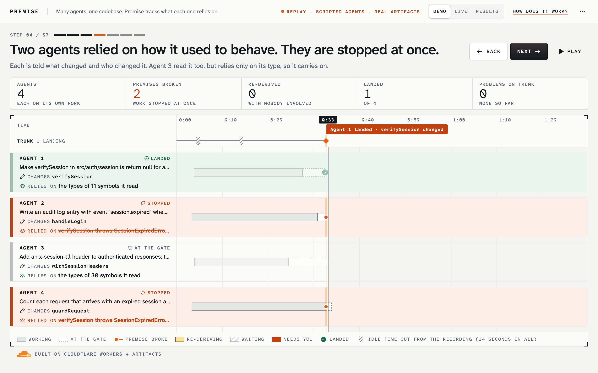
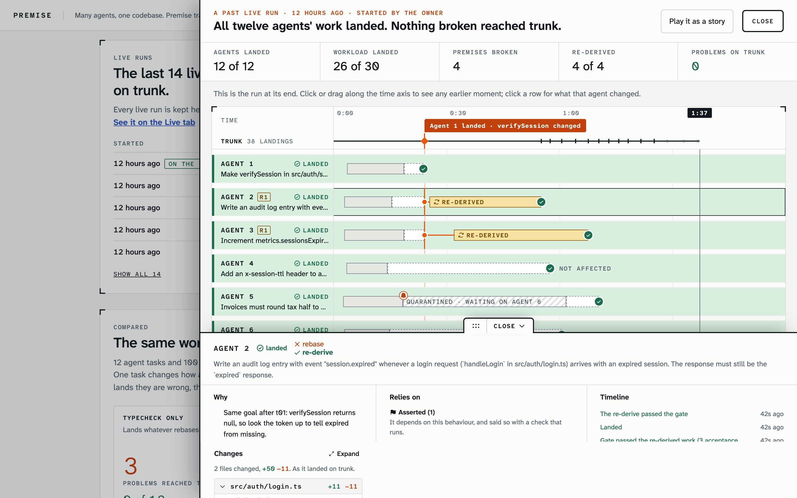

<p align="center">
  
</p>

<h1 align="center">Premise</h1>

<p align="center">
  <strong>Git tracks what agents wrote. Premise tracks what they assumed.</strong><br>
  When an assumption breaks, Premise stops the work that depended on it and redoes it.
</p>

<p align="center">
  <a href="https://premise.akshatdivekar.workers.dev/"><strong>Try the live demo</strong></a> ·
  <a href="https://premise.akshatdivekar.workers.dev/slides/">How it works (slides)</a> ·
  <a href="#run-it-on-your-computer">Run it locally</a> ·
  <a href="docs/DETAILS.md">The details</a>
</p>

<p align="center">
  
</p>

## What is Premise?

Many AI coding agents can work on one codebase at the same time. The changes that hurt are not the ones that conflict. They are the quiet ones: a change touches different files, still compiles, passes its tests, and is still wrong, because another agent's code relied on the old behaviour.

Premise is a Git platform, built on [Cloudflare Workers](https://developers.cloudflare.com/workers/) and [Artifacts](https://developers.cloudflare.com/artifacts/), that catches this:

- **Each agent works on an Intent**: its job, written down, in its own fork of the code.
- **Premise records what each agent relies on** (its **premises**): the functions it read, and any behaviour it depends on, written as a small check that can run.
- **When something lands, Premise checks every premise again.** Work whose premise broke is stopped at once, and the agent is told what changed and who changed it.
- **Stopped work is redone** (we call it **re-derive**) on the new code, and goes through the **gate**: typecheck, tests, reference checks and premises. Only then does it land on **trunk**, the shared code.

## Try it in your browser

No install and no account needed.

| | |
|---|---|
| **[Demo](https://premise.akshatdivekar.workers.dev/)** | A real run of four agents on Cloudflare, told in seven steps. Press **Next**. |
| **[Live](https://premise.akshatdivekar.workers.dev/?live)** | Press **Start a run** to watch twelve agents work on real Cloudflare Artifacts (three to four minutes). |
| **[Results](https://premise.akshatdivekar.workers.dev/?results)** | Every live run, the numbers, and a comparison with other ways of landing work. Click a run to open it. |

<p align="center">
  
</p>

## Run it on your computer

You need [Node.js](https://nodejs.org/) 22 (22.12 or later) or 24. You do **not** need a Cloudflare account or an AI key: locally, the code is held in memory and the agents replay scripted turns.

**1. Get the code and install**

```bash
git clone https://github.com/akshat12/premise.git
cd premise
npm install
cp local.vars.example .dev.vars
```

**2. Start it**

```bash
npm run dev:local
```

It prints an address, usually <http://localhost:5173>. Open it to see the demo.

**3. Start a run** (in a second terminal, in the same folder)

```bash
npm run demo -- --no-open
```

Then open <http://localhost:5173/?live> to watch it. Locally a run takes about fifteen seconds. (The script also prints a link ending in `&admin`: that shows the owner's tools, which are harmless on your own machine.)

You can also press **Start a run** on the Live tab instead. After a run, that button waits about three minutes before it can start another; `npm run demo` can start one at any time.

> **If it printed a different port** (for example `http://localhost:5174`), use that port in the addresses above, and run the demo with it: `npm run demo -- --no-open --url http://localhost:5174`.

**4. Run the tests** (optional; stop the server first with `Ctrl+C`)

```bash
npm test             # about 1,090 tests, two to three minutes
npm run typecheck
```

While the tests run you will see many error-looking lines, such as "uncaught exception … canceled this request", "Aborting engine: User called terminate" and "Workflow instance … terminated". That is expected: some tests start background work and then stop it on purpose. The summary at the end is what counts.

## Deploy your own

Deploying puts Premise on **your own** Cloudflare account, with your own admin token and, if you want real AI agents, your own model key. It needs the Workers Paid plan (Artifacts requires it). Step by step: **[docs/DEPLOY.md](docs/DEPLOY.md)**.

## How it works

<p align="center">
  
</p>

- **Artifacts** holds trunk and one fork per Intent.
- **Durable Objects** hold the state: the **ledger** (who is changing and relying on what), each Intent, the **gate**, and the event log.
- **Workflows** run each agent.
- **Dynamic Workers** run every test and premise check in its own isolate, with no network.
- **The TypeScript compiler runs inside the Worker** for typechecks. No containers.

## Results

The same 12 tasks, landed under three rules, on real Artifacts:

| | Typecheck only | Queue that also runs the tests | Premise |
|---|---|---|---|
| Broken changes that reached trunk | 3 | 1 | **0** |
| Tasks handed back to a person | 0 of 12 | 2 of 12 | **0 of 12** |

To be clear about the setup: the breaking change is planted, the agents are scripted, and Premise is the slowest of the three. It shows a mechanism working, not how often this happens to a real team. The full numbers and how to read them: [docs/DETAILS.md](docs/DETAILS.md) and [docs/ab-results.md](docs/ab-results.md).

## Limitations

- **A small, constructed scenario:** twelve pre-written tasks in one small TypeScript repo. You cannot yet point it at your own repo.
- **Scripted agents** in the demo and the comparison. Real models have been tried; what happened is written up in [docs/DETAILS.md](docs/DETAILS.md#what-a-model-does-on-its-own).
- **Behaviour is only tracked if someone states it** as a check. Types are tracked automatically.
- **One gate for all of trunk**, so landings wait for each other. How it would scale: [docs/DETAILS.md](docs/DETAILS.md#how-this-would-scale).

## More

- [The details](docs/DETAILS.md): the scenario, the full comparison, live-model runs, where the ideas come from, all the limitations, scaling.
- [Deploy your own](docs/DEPLOY.md), including other commands and how to use a real model.
- [How it works, as slides](https://premise.akshatdivekar.workers.dev/slides/).
- The repo the agents work on: [akshat12/acme-accounts](https://github.com/akshat12/acme-accounts) (a copy of [`demo-repo/`](demo-repo)).

## Licence

[MIT](LICENSE).
