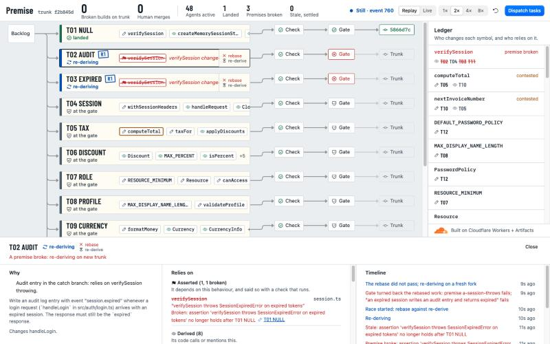

# Premise

> Git tracks what agents wrote. Premise tracks what they assumed, and re-derives the work the moment an assumption breaks.

Premise is a Git platform for many coding agents changing one codebase at once. It is built on Cloudflare Workers and [Artifacts](https://developers.cloudflare.com/artifacts/).



## The idea in 20 seconds

- **Intent.** Each agent works on an Intent in its own Artifacts fork. An Intent has a goal, acceptance checks that cannot be edited after dispatch, the symbols it **changes**, and the symbols it **relies on**. The second list is its premises.
- **Invalidation.** When anything lands on trunk, every Intent still in flight whose premises no longer hold goes red, with one line saying what changed and who changed it. This happens even when the typecheck is green and the text does not conflict.
- **Re-derive.** A stale Intent does not get a blind rebase. Its agent runs again on a fresh fork of the new trunk, racing a plain textual rebase. Whichever result passes the **gate** (typecheck, tests, premise assertions) lands.

The case the demo is built around: one Intent changes `verifySession` to return `null` for an expired session instead of throwing. The signature is unchanged, so the typecheck passes. Three other Intents wrote code that catches the throw. Each of them had recorded "verifySession throws on an expired token" as a premise, so all three go red the moment the change lands, and each is re-derived against the new behaviour before it can reach trunk.

## What it buys

The same 12 tasks and the same 100 scripted workload Intents (seed 7), run twice on real Artifacts on 2026-10-10. The baseline lands work on a clean textual rebase plus a typecheck. Premise is the full system. The rebase and typecheck code is the same in both.

| | Baseline | Premise |
|---|---|---|
| Behavioural regressions that reached trunk | 3 | 0 |
| Human merges | 11 | 0 |
| Broken builds on trunk | 0 | 0 |
| Demo tasks landed | 12 of 12 | 12 of 12 |
| Intents landed | 100 of 111 | 97 of 112 |
| Landings per minute | 50.8 | 42.1 |
| Wall time | 118.1 s | 138.2 s |
| Premises broken | 0 | 27 |
| Stale Intents settled by re-derive | 0 | 3 |
| Stale Intents a plain rebase settled | 0 | 16 |
| False-positive rate | n/a | 76% |
| Turned away at the gate | 11 text, 0 type, 0 checks | 0 text, 0 type, 3 checks |
| Gave up waiting for a claim | 0 | 15 |
| Reference tests red at the end | 3 | 0 |
| Forks created | 111 | 115 |

The cost is in the table too. Premise was 17% slower, and 76% of the Intents it turned stale would have landed on a plain rebase anyway. What each row means, and how to run the comparison yourself, is in [docs/ab-results.md](docs/ab-results.md).

## See it in 2 minutes

- **Recorded run:** <https://premise.akshatdivekar.workers.dev/?demo=main>. This is a real run of the deployed system (12 tasks and 300 workload Intents on Artifacts), replayed in the browser. Press `→` to jump between key moments: the stalemate card, the premise break, each re-derive race. `Space` pauses, `1` `2` `4` set the speed, `?` lists every key.
- **Scale and A/B:** the tabs next to "Lanes" in the top bar.
- **Video:** _link to come_.

## Architecture


- **Artifacts** holds trunk and one fork per Intent. Forks and reads go through the Worker binding; writes are git over HTTPS (isomorphic-git inside the Worker), with a short-lived token for that one fork. Agents never hold a token for trunk.
- **AgentWorkflow** is one durable Workflow run per Intent. The agent has read, search and write tools and no shell, so everything it reads is recorded. The model sits behind a port: Anthropic, OpenAI, Google, OpenRouter, Groq, Workers AI, or scripted turns.
- **LedgerShard** Durable Objects, one per module path, know who changes each symbol and who relies on it. Two Intents that want the same symbol get one of three fixed answers: **Wait**, **Split** or **Depend**.
- **Landing** is the gate, one Durable Object per trunk. It rebases, typechecks, runs the Intent's acceptance tests and premise assertions, runs the acceptance tests of work that has already landed, and only then pushes to trunk. It also runs the re-derive race for stale Intents and calls a person after two failures.
- **The TypeScript compiler runs inside the Worker** for typechecks and type-surface hashes. Tests and assertions run in **Dynamic Workers** (the Worker Loader), one isolate per run, with no network.
- **EventHub** is the single event log. The UI is a pure function of that log, which is why a recorded run replays exactly.
- **Queues** carry Artifacts events (pushes to trunk, forks) to the Worker, so a push to trunk from outside the gate still invalidates premises.

## How premises work

An Intent's premises come from three sources:

1. **Observed.** The agent read the symbol through its tools. Reading a whole file records every symbol the file exports.
2. **Derived.** The agent's own diff calls, imports or implements the symbol. The Worker works this out with the TypeScript compiler after each push.
3. **Asserted.** The agent stated a behaviour it depends on as an executable check, for example "`verifySession` throws `SessionExpiredError` on an expired token".

For observed and derived premises, Premise stores a hash of the symbol's **type surface**: its exported signature and the types that reach it. Function bodies are left out on purpose. Bodies change all the time, and most of those changes do not matter to callers. Hashing them would turn every Intent that read a function stale on every edit to it.

That leaves behaviour, which a signature cannot describe. Behaviour lives in **assertions**: small executable checks that are run again on the new trunk every time something lands. This is what catches the `verifySession` change above, which no typecheck can see.

Premises are the early warning; the gate is the guarantee. A premise that breaks tells an agent early and tells it exactly what changed. Whether or not any premise was recorded, nothing reaches trunk without passing the gate, and landed work is protected by its own acceptance tests from then on.

## Run it yourself

### Local only (no Cloudflare account, no model key)

Needs Node 22 or later.

```bash
git clone <this repo> premise && cd premise
npm install
cp local.vars.example .dev.vars    # in-memory repos, scripted agents, a local admin token
npm run dev:local                  # http://localhost:5173
```

In a second terminal:

```bash
npm run demo                       # resets, dispatches 12 tasks and 40 workload Intents, opens the live board
```

Or open <http://localhost:5173/?demo=main> to play the recorded run, which needs no backend at all. `npm test` runs the test suite and `npm run typecheck` the type checks.

In this mode repos are held in memory and agents replay recorded turns, but everything else is the real code: the ledger, the gate, the TypeScript compiler, the isolate runner, invalidation and re-derive.

`npm run dev:local` uses `wrangler.local.jsonc`, which leaves out the Artifacts binding. Plain `npm run dev` uses `wrangler.jsonc`, where that binding is remote even in dev, so it needs `npx wrangler login` first.

### Deployed, on real Artifacts

Needs the Workers Paid plan (Artifacts requires it) and Node 22 or later. A model key is optional: without one the agents replay recorded turns.

1. Install and log in.
   ```bash
   npm install
   npx wrangler login
   ```
2. In `wrangler.jsonc`, set `CLOUDFLARE_ACCOUNT_ID` to your account id (`npx wrangler whoami` prints it).
3. Create the queue.
   ```bash
   npx wrangler queues create premise-events
   ```
4. Deploy. The URL it prints is `<your worker>` below.
   ```bash
   npm run deploy
   ```
5. Set the secrets. Choose any long random string as the admin token.
   ```bash
   npx wrangler secret put ADMIN_TOKEN
   npx wrangler secret put ANTHROPIC_API_KEY    # optional; see "Using a real model"
   ```
   Put the same admin token in a git-ignored file so the scripts can use it: `echo "ADMIN_TOKEN=<your token>" > .env.deployed`
6. Import trunk. This imports the demo repo ([akshat12/acme-accounts](https://github.com/akshat12/acme-accounts), a copy of `demo-repo/`) into Artifacts.
   ```bash
   curl -X POST <your worker>/api/admin/import-trunk -H "x-admin-token: <your token>"
   ```
7. Create the two event subscriptions.
   ```bash
   npx wrangler queues subscription create premise-events --source artifacts --events repo.created,repo.forked,repo.imported,repo.deleted --name premise-account
   npx wrangler queues subscription create premise-events --source artifacts.repo --events pushed --source-namespace premise --source-repo-name trunk --name premise-trunk-push
   ```
8. Run the demo.
   ```bash
   npm run demo -- --url <your worker>
   ```

Other commands:

| Command | What it does |
|---|---|
| `npm run smoke` | Runs the repo-store contract against real Artifacts on the deployed Worker |
| `npx tsx scripts/ab.ts --url <your worker>` | Runs the A/B comparison and rewrites `docs/ab-results.md` |
| `npm run demo:record -- --url <your worker> --out demo/runs/mine.json` | Records a run; play it at `/?demo=mine` |
| `npm run demo:compress -- demo/runs/mine.json` | Cuts idle time out of a recording and marks each cut |

### Using a real model

Set `LLM` to a provider and give it a key. Nothing else changes.

| `LLM` | Key |
|---|---|
| `anthropic` | `ANTHROPIC_API_KEY` |
| `openai` | `OPENAI_API_KEY` |
| `google` | `GEMINI_API_KEY` |
| `openrouter` | `OPENROUTER_API_KEY` |
| `groq` | `GROQ_API_KEY` |
| `workers-ai` | `CLOUDFLARE_API_TOKEN` |
| `scripted` | none |

Locally, put both in `.dev.vars`. Deployed, set the key with `wrangler secret put`, then choose the provider without a redeploy:

```bash
curl -X POST <your worker>/api/admin/llm -H "x-admin-token: <your token>" -H "content-type: application/json" -d '{"provider":"google","model":"gemini-3.5-flash-lite"}'
```

## Limitations

- **TypeScript only.** Symbols, type surfaces and the typecheck all come from the TypeScript compiler.
- **Workload agents are scripted.** The hundreds of "workload" Intents do real forks, pushes and landings on Artifacts, but a seeded generator writes their edits, not a model. They are labelled as scripted everywhere they appear.
- **The agents in the recorded run are scripted too.** They replay turns built from reference solutions, so the recording is repeatable. The same pipeline has been run with a live model (Gemini 3.1 Flash-Lite) on a handful of tasks, including a premise break that the model re-derived, but not yet on all twelve at once.
- **Enforcement happens after the push.** Artifacts has no pre-receive hook, so an agent can push an edit to a symbol it did not claim. The push checker catches it afterwards and quarantines the Intent, and the gate is what stops it reaching trunk.
- **Landings are serialized.** One Durable Object per trunk runs the gate, in batches. In the 300-Intent run that was about 53 landings a minute.
- **Premises have false positives.** In the A/B run, 76% of the Intents that went stale would have landed on a plain rebase. A broken premise costs time even when it turns out not to matter.
- **Acceptance checks are only as good as their tests.** Landed work is protected by the tests it landed with; behaviour nobody tested or asserted is not protected.

## Repository layout

```
src/shared/     types and events shared by the Worker and the UI
src/worker/     the Worker: ledger, Intent state machine, agent Workflow, gate, event hub, workload, A/B
src/ui/         the React + Kumo app
demo-repo/      the TypeScript repo the agents work on (imported into Artifacts as trunk)
demo/runs/      recorded runs, played at /?demo=<name>
scripts/        demo, record, compress, smoke, A/B
docs/           the spec, the plan, decisions, A/B results, screenshots
```

## Licence

[MIT](LICENSE).
