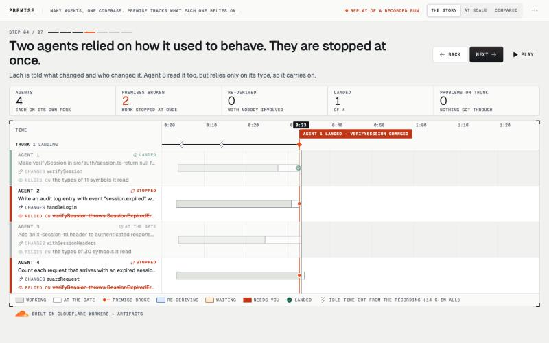
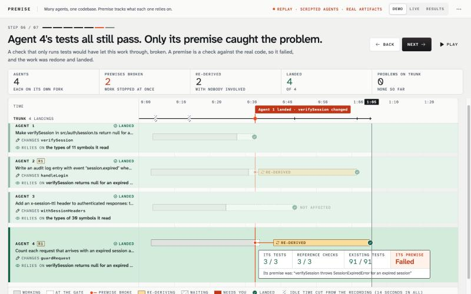
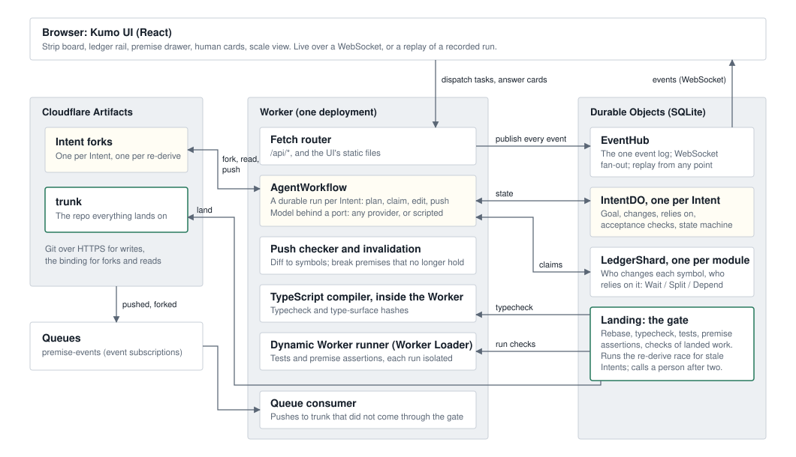

# Premise

> Git tracks what agents wrote. Premise tracks what they assumed, and re-derives the work the moment an assumption breaks.

When many agents change one codebase at once, the changes that hurt are not the ones that conflict. They are the ones that rebase cleanly, typecheck, and are wrong, because another agent changed what the code was relying on. Premise is a Git platform, built on Cloudflare Workers and [Artifacts](https://developers.cloudflare.com/artifacts/), that records what each agent's work relies on and acts when that stops being true.

**See it now:** <https://premise.akshatdivekar.workers.dev/> walks through a real run of four agents in seven steps. Press **Next** (or `→`) and read the sentence at the top.



## The idea in 20 seconds

- **Intent.** Each agent works on an Intent in its own Artifacts fork. An Intent has a goal, acceptance checks, the symbols it **changes**, and the symbols it **relies on**. The second list is its premises.
- **Invalidation.** When anything lands on trunk, every Intent still in flight whose premises no longer hold is stopped at once, with one line saying what changed and who changed it.
- **Re-derive.** A stale Intent first tries a plain rebase, which takes about a second. If that does not pass the **gate**, its agent redoes the work on a fresh fork of the new trunk, told what broke.
- **The gate.** Nothing reaches trunk without a clean rebase, a typecheck, the Intent's own tests, the task's reference checks (kept on trunk where no agent can write them), every test already on trunk, and the Intent's premise assertions.

The case the demo is built around, with four agents (the page calls them Agent 1 to 4; in the repo they are tasks T01, T02, T04 and T11):

- **Agent 1** changes `verifySession` to return `null` for an expired session instead of throwing. The signature is unchanged, so the typecheck passes.
- **Agent 2** wrote code that catches the throw. After a rebase its own tests fail. Its work is redone and lands.
- **Agent 3** read the same function but relies only on its types. Nothing happens to it.
- **Agent 4** also catches the throw, but its tests use a stand-in for `verifySession`. After a rebase every test passes. Only its premise is red. Its work is redone and lands.

## What the comparison shows, and what it does not

The same 12 tasks and 100 scripted workload Intents, landed under three rules, on seeds 7, 11 and 23, on the deployed Worker and real Artifacts (2026-10-11). The first two rules are comparisons; the middle one is the fair one.

| | Typecheck only | Queue that also runs tests | Premise |
|---|---|---|---|
| Behavioural regressions that reached trunk | 3 | 1 | 0 |
| Demo tasks sent back to a person | 0 of 12 | 2 of 12 | 0 of 12 |
| Stopped Intents redone and landed with nobody involved | 0 | 0 | 3 |
| Scripted workload Intents that did not land | 9 to 11 | 10 to 11 | 12 to 14 |
| Wall time | 85 to 90 s | 79 to 91 s | 103 to 145 s |

Read it knowing how the run is set up:

- **The breaking change is planted, and it lands before any other task** in every run. (In these runs a scripted workload landing could still come first; the gate has since been changed to hold those too.) This shows a mechanism working. It is not a measurement of how often real teams hit this.
- **A queue that runs tests catches two of the three.** Their own tests fail after the rebase. There the difference is only what happens next: the queue turns the work away and stops, and Premise re-derives it and lands it.
- **The third is the case tests miss, and it is built to be.** Its tests check the rate limiter with a stand-in for the session check, the way unit tests often do. The stand-in still throws, so every test passes after the rebase while the real path is broken. Only its premise, an executable assertion about the real `verifySession`, is red. A premise is the assumption a stand-in encodes, checked against the real thing.
- **Premise is slower and lands fewer workload Intents.** Scripted Intents that want a symbol another Intent holds give up after three more tries. In the two queues the same collisions are text conflicts for a person.
- **Most broken premises change nothing.** Nearly all are type-surface changes, and every one of the 14 to 21 workload Intents they turned stale passed the whole gate on a plain rebase a second later. Of the agents' stale Intents, 0 or 1 in each run did.
- **The agents are scripted,** and Artifacts refused some forks under load: each run asks for 112 Intents, and between 93 and 112 of them got a fork, so the totals differ between runs. For each rule, the outcome for the twelve tasks was the same on every seed.

Every row, what it means, and the per-seed results are in [docs/ab-results.md](docs/ab-results.md).

## See it in 2 minutes

- **The story:** <https://premise.akshatdivekar.workers.dev/>. A real run of the deployed system on Artifacts, told in seven steps: the four agents above, each on its own fork, drawn as four rows over time. **Next** and **Back** (or `→` and `←`) move between the steps, **Play** runs it through at normal speed, and clicking a row opens that agent's Intent: why it did what it did, what it relies on, its story, and its changes.
- **At scale:** the numbers from a larger run of the same system, twelve agents and 294 scripted workload Intents (309 forks, 266 Intents landed in about four minutes). <https://premise.akshatdivekar.workers.dev/?demo=scale> walks through it.
- **Compared:** the three-rule comparison above.
- **With a live model:** <https://premise.akshatdivekar.workers.dev/?demo=live> replays the same four tasks with Gemini 3.5 Flash-Lite as every agent. See "What a model does on its own" for what happened.
- **Video:** _link to come_.

The agents in the first two demo recordings are scripted: their turns are generated from reference solutions, so a run is repeatable and needs no model key. Everything else is real: the forks, pushes, typechecks, tests, premise checks and landings happened on Cloudflare on 2026-10-11, and the replay is that run's event log.



## How premises work

An Intent's premises come from three sources:

1. **Observed.** The agent read the symbol through its tools. The agent has no shell, so everything it reads is recorded.
2. **Derived.** The agent's own diff calls, imports or implements the symbol. The Worker works this out from the parsed code after each push.
3. **Asserted.** The agent stated a behaviour it depends on as an executable check, for example "`verifySession` throws `SessionExpiredError` for an expired session".

For observed and derived premises, Premise stores a hash of the symbol's **type surface**: its exported signature and the types that reach it. Function bodies are left out on purpose, because hashing them would turn every reader stale on every edit. A type-surface premise mostly repeats what the gate's typecheck would find later; what it adds is that the agent hears at once, by name.

Behaviour is what a signature cannot describe. It lives in **assertions**, which run again on the new trunk every time something lands. Before a plan is accepted, the agent is asked one question: does this depend on how any function you are not changing behaves? It answers with an assertion or by saying no.

Premises are the early warning; the gate is the guarantee. When an Intent lands, its tests, its reference checks and its assertions stay behind as checks on every later landing, so work that landed first is protected from work that lands after it.

## What a model does on its own

The front-page demo recording and the A/B use scripted agents. Two things have been run with a live model, with no hint in any task about what to assert. (T11's hint does tell the agent to test `guardRequest` with a stand-in for the session check. That is how the scenario is built: it is what makes its tests blind to the change.)

**The four front-page tasks on the deployed Worker and real Artifacts** (Gemini 3.5 Flash-Lite as all four agents, 2026-10-11; replay it at [`/?demo=live`](https://premise.akshatdivekar.workers.dev/?demo=live)). All four landed in seven minutes with nobody involved, most of that waiting on the model's rate limit. **One of them landed wrong:** the run ended with one behavioural regression on trunk.

- Every agent adopted the assertion "`verifySession` throws on expired tokens" from the repo's assertion library.
- T01, which changes that function, had its own assertion withdrawn when it declared the change, and landed.
- T11's first attempt went the way the scripted run does: the model wrote its tests with a stand-in, as its task hint says to, so after the rebase all its tests, the reference checks and trunk's suite passed, and only its premise failed. It was stopped.
- **T11's redo was the same change again, and it landed.** The model did not adapt to the new behaviour; it made the identical edit and asserted something weaker. Every test passed, as before, and this time no premise failed. The end-to-end probe is red on trunk: a client replaying an expired session is not rate-limited. So the premise caught the problem once, and the re-derive let it back in. Since this run, a redo that is the same change as the stopped work is turned back at the gate without being run.
- T02 was stopped while still working, redone, and landed.
- T04, the control, also adopted the assertion, although its code does not depend on it. So it was stopped and redone for nothing. That is a false positive caused by a model asserting more than it needs.

**The same four tasks again, after that gate check went in** (2026-10-12, same model; the raw log is `demo/raw/live2.json`). All four landed, in six and a half minutes, and **the run again ended with one behavioural regression on trunk**, from T11, for a different reason:

- T11 was stopped before it had pushed anything, so there was no stopped work for its redo to be compared with.
- On the redo the model read the new `verifySession`, tried to adopt the same "throws on expired tokens" assertion again (the briefing still offered it, although it was no longer true), was refused, said its plan relied on no behaviour, and wrote the old catch-block code with a stand-in test that throws. Every check at the gate passed.
- T04 again adopted the assertion for nothing, was stopped, and its first redo ran out of turns before the second landed.

Two changes came out of that, both in what a re-deriving agent is told, and neither has been run on Cloudflare with a live model yet. An assertion from the library is only offered if it holds on the agent's fork. And a redo that was stopped over an asserted premise cannot declare its plan until it has asserted something that holds today about the same symbol; "I rely on nothing" is not accepted for it. Locally (in-memory repo, T11 as a redo, three runs) the model then always asserted something about `verifySession`, the right thing once. One run's work passed the end-to-end probe but failed a reference check, so the gate would have turned it back. One failed both. One passed every gate check and failed the probe, so it would have landed wrong. None of the three would have landed right. So this narrows the hole and does not close it: when a task's tests and its reference checks both use a stand-in, a wrong redo with a true premise still lands.

**Whether a model asserts unprompted** (Gemini 3.1 Flash-Lite, the tasks that depend on `verifySession`, on the in-memory repo):

| Setup | Wrote or adopted a correct assertion about `verifySession` |
|---|---|
| The repo's assertion library is visible | 3 of 3 runs (adopted it) |
| No library, and the plan is not asked the question | 0 of 3 runs |
| No library, and the plan is asked the question | 2 of 6 runs (wrote its own) |

In all six runs of the last row the work itself passed the task's reference checks. So a small model reliably takes an assertion it is offered, sometimes when it should not, writes a good one of its own about a third of the time, and may redo stopped work without fixing it. Without an assertion, a task whose tests cover the behaviour is still stopped at the gate; one whose tests use a stand-in would land broken. Twelve live agents at once has not been run.

## Where this comes from

Little here is new on its own. The parts are borrowed, and the combination is the contribution.

- **Validating what you read, not only what you wrote,** is optimistic concurrency control (Kung and Robinson, 1981). A premise is a read-set entry; invalidation is validation at commit time, moved earlier.
- **Hashing an interface and ignoring bodies** is how build systems avoid rebuilding dependents (Bazel's interface jars, TypeScript's declaration signatures).
- **Testing each change on top of the latest trunk before it lands** is what careful teams' landing queues already do. Premise's gate is one of those, and the A/B measures against one.
- **Claims on symbols before editing** follow from lock and lease systems, and from recent multi-agent coding tools that reserve files or regions.
- What Premise adds is the read-set of an *agent's reasoning*: recording what was read as the agent reads it, asking for the behavioural part as an executable check, telling the dependent agent the moment it breaks, and redoing the work from the stored goal instead of merging text.

## Architecture



- **Artifacts** holds trunk and one fork per Intent. Forks and reads go through the Worker binding; writes are git over HTTPS (isomorphic-git inside the Worker), with a short-lived token for that one fork. Agents never hold a token for trunk.
- **AgentWorkflow** is one durable Workflow run per Intent. The model sits behind a port with adapters for Anthropic, OpenAI, Google, OpenRouter, Groq and Workers AI, and scripted turns. Only Google's has been run end to end.
- **LedgerShard** Durable Objects, one per module path, know who changes each symbol and who relies on it. Two Intents that want the same symbol get **Wait**, **Split** or **Depend**. Claims are renewed while the agent works and lapse if it dies.
- **Landing** is the gate, one Durable Object per trunk. It also schedules re-derives and calls a person after two have failed.
- **The TypeScript compiler runs inside the Worker** for typechecks and type-surface hashes. Tests and assertions run in **Dynamic Workers** (the Worker Loader), one isolate per run, with no network.
- **EventHub** is the single event log. The UI is a pure function of that log, which is why a recorded run replays exactly.
- **Queues** are wired to carry Artifacts events to the Worker, so a push to trunk from outside the gate also invalidates premises. That path is implemented and unit-tested; it has not been exercised on the deployed Worker.

## Run it yourself

Needs Node 22 or later. No Cloudflare account and no model key:

```bash
git clone <this repo> premise && cd premise
npm install
cp local.vars.example .dev.vars    # in-memory repos, scripted agents, a local admin token
npm run dev:local                  # http://localhost:5173
```

In a second terminal:

```bash
npm run demo                       # resets, dispatches 12 tasks and 40 workload Intents, opens the live board
```

<http://localhost:5173/> plays the demo recording, which needs no backend at all. `npm test` runs the tests (about 880, in under two minutes) and `npm run typecheck` the type checks. `npx tsx scripts/ab.ts --url http://localhost:5173 --seeds 7,11,23` reruns the comparison above against the local Worker (the three headline rows come out the same; it takes about ten seconds a run instead of ninety). It resets the local demo first and writes its report to `docs/ab-results.local.md`, leaving the committed results alone.

In this mode repos are held in memory and agents replay scripted turns, but everything else is the real code: the ledger, the gate, the TypeScript compiler, the isolate runner, invalidation and re-derive.

<details>
<summary><strong>Deployed, on real Artifacts</strong> (needs the Workers Paid plan)</summary>

Needs the Workers Paid plan (Artifacts requires it) and Node 22 or later. A model key is optional: without one the agents replay scripted turns.

1. Install and log in.
   ```bash
   npm install
   npx wrangler login
   ```
2. In `wrangler.jsonc`, set `CLOUDFLARE_ACCOUNT_ID` to your account id (`npx wrangler whoami` prints it).
3. Create the queue.
   ```bash
   npx wrangler queues create premise-events
   ```
4. Deploy. The URL it prints is `<your worker>` below.
   ```bash
   npm run deploy
   ```
5. Set the secrets. Choose any long random string as the admin token.
   ```bash
   npx wrangler secret put ADMIN_TOKEN
   npx wrangler secret put GEMINI_API_KEY       # optional; see "Using a real model"
   ```
   Put the same admin token in a git-ignored file so the scripts can use it: `echo "ADMIN_TOKEN=<your token>" > .env.deployed`
6. Import trunk. This imports the demo repo ([akshat12/acme-accounts](https://github.com/akshat12/acme-accounts), a copy of `demo-repo/`) into Artifacts.
   ```bash
   curl -X POST <your worker>/api/admin/import-trunk -H "x-admin-token: <your token>"
   ```
7. Create the two event subscriptions.
   ```bash
   npx wrangler queues subscription create premise-events --source artifacts --events repo.created,repo.forked,repo.imported,repo.deleted --name premise-account
   npx wrangler queues subscription create premise-events --source artifacts.repo --events pushed --source-namespace premise --source-repo-name trunk --name premise-trunk-push
   ```
   The second one covers the repo named `trunk`. A demo reset moves trunk to a fresh repo (`trunk-<time>`), which this subscription does not cover, so after a reset a push from outside the gate is not seen until a subscription is made for the new repo.
8. Run the demo.
   ```bash
   npm run demo -- --url <your worker>
   ```

Other commands:

| Command | What it does |
|---|---|
| `PREMISE_URL=<your worker> npm run smoke` | Runs the repo-store contract against real Artifacts on the deployed Worker |
| `npx tsx scripts/ab.ts --url <your worker> --seeds 7,11,23` | Runs the A/B comparison (one seed, 7, if `--seeds` is left out) and rewrites `docs/ab-results.md` and `.json` |
| `npm run demo:record -- --url <your worker> --out demo/runs/mine.json` | Records a run. Recordings are bundled at build time, so play it at `/?demo=mine` locally, or after the next deploy |
| `npm run demo:compress -- demo/runs/mine.json` | Cuts idle time out of a recording and marks each cut |
| `npm run demo:offline` | Builds, then serves the UI as plain files with no backend: the recorded run at `http://localhost:4173/?demo=main` |

</details>

<details>
<summary><strong>Using a real model</strong></summary>

Set `LLM` to a provider and give it a key. Nothing else changes.

| `LLM` | Key |
|---|---|
| `anthropic` | `ANTHROPIC_API_KEY` |
| `openai` | `OPENAI_API_KEY` |
| `google` | `GEMINI_API_KEY` |
| `openrouter` | `OPENROUTER_API_KEY` |
| `groq` | `GROQ_API_KEY` |
| `workers-ai` | `CLOUDFLARE_API_TOKEN` |
| `scripted` | none |

Locally, put both in `.dev.vars`. Deployed, set the key with `wrangler secret put`, then choose the provider without a redeploy:

```bash
curl -X POST <your worker>/api/admin/llm -H "x-admin-token: <your token>" -H "content-type: application/json" -d '{"provider":"google","model":"gemini-3.5-flash-lite"}'
```

</details>

## Limitations

- **A constructed scenario.** Twelve pre-written tasks in one small TypeScript repo with no dependencies and its own test format. There is no way yet to give it your own goal or your own repo, and no interface for an agent that is not Premise's own.
- **Scripted agents in the recording and the A/B.** Their turns, including the assertions, are generated from reference solutions. The hundreds of workload Intents do real forks, pushes and landings, but a seeded generator writes their edits, and they have no tests. They are labelled as scripted wherever they appear.
- **Behaviour is tracked only if someone asserts it.** See "What a model does on its own". Observed and derived premises cover types, which the gate's typecheck also covers.
- **The agent writes its own acceptance tests.** Only their names are fixed. What it cannot touch are the task's reference checks, which the gate runs from trunk's copy. A task with no reference checks would be gated on the agent's own tests and trunk's suite.
- **False positives.** Most broken premises are type-surface changes that turn out not to matter. For an Intent that has already pushed, the cost is one rebase at the gate. For one still working, the agent is stopped and starts again.
- **Wait and Depend both pause the Intent** until the other lands. The dependency is recorded on the Intent only when a person chooses Depend; the ledger's own Depend answer behaves as Wait. Neither re-forks the waiter, so if the holder's landing changed what the waiter read, the waiter goes stale then and is re-derived.
- **Scale with real models is unknown.** One Durable Object per trunk runs the gate. The 61 landings a minute in the larger demo recording are batches of ten scripted edits; agents' Intents are gated one at a time, at two to five seconds each. In that run 6 of 300 workload forks failed after retries, and 40 of 294 workload Intents did not land: 33 gave up waiting for a claim, and 7 were wrongly failed by the scripted runner when a premise broke just as they were being queued (fixed since).
- **Enforcement happens after the push.** Artifacts has no pre-receive hook, so an agent can push an edit to a symbol it did not claim. The push checker catches it afterwards and quarantines the Intent, and the gate is what stops it reaching trunk.
- **A scripted re-derive can undo a workload edit.** It writes whole files from its script, so if a workload Intent landed an edit to the same file in the meantime, that edit is silently dropped. A real agent reads the current file. This bears on the "Intents landed" counts in the A/B and the larger recording.
- **Little is cleaned up.** A demo reset removes the forks and clears the log, the ledger and the gate. The Durable Objects and Workflow instances of finished Intents are never deleted.

## Repository layout

```
src/shared/     types and events shared by the Worker and the UI
src/worker/     the Worker: ledger, Intent state machine, agent Workflow, gate, event hub, workload, A/B
src/ui/         the React + Kumo app
demo-repo/      the TypeScript repo the agents work on (imported into Artifacts as trunk)
demo/runs/      recorded runs, played at /?demo=<name>
scripts/        demo, record, compress, smoke, A/B
docs/           the spec, the plan, decisions, A/B results, screenshots
```

## Licence

[MIT](LICENSE).
